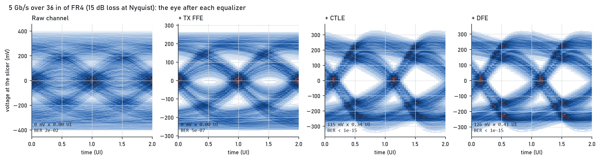
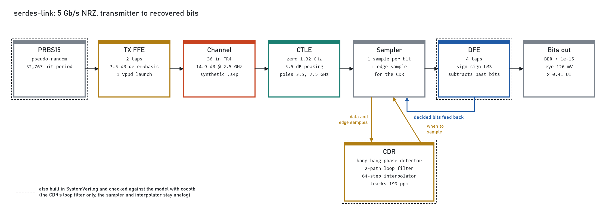
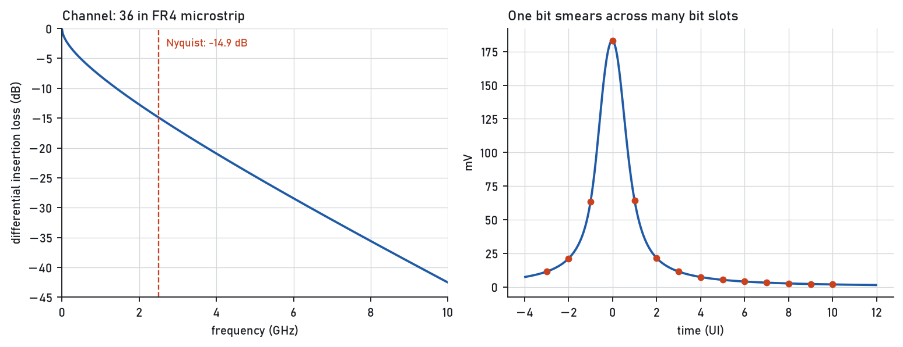
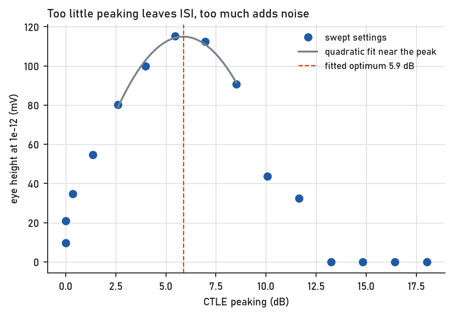
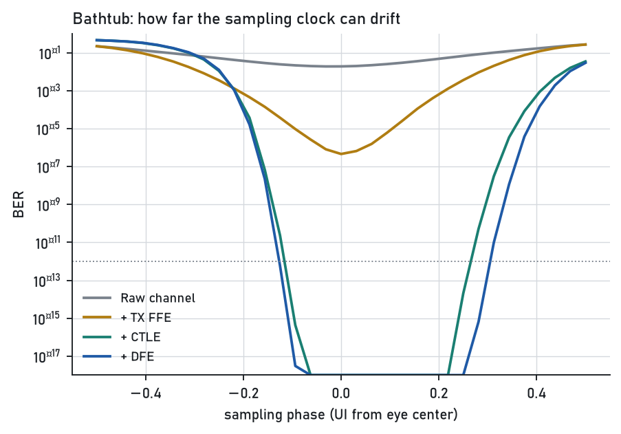
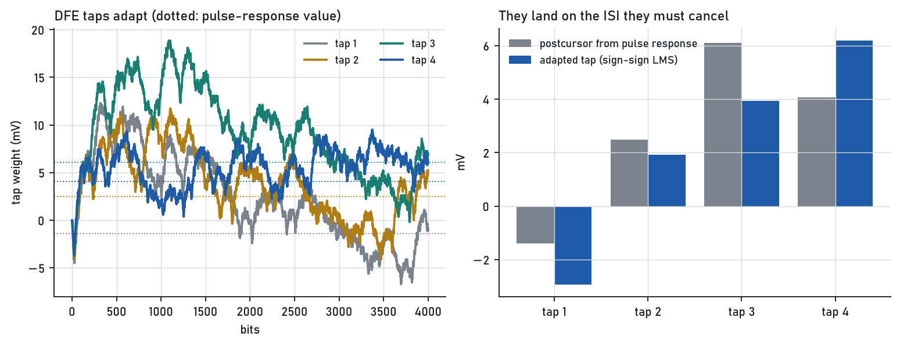
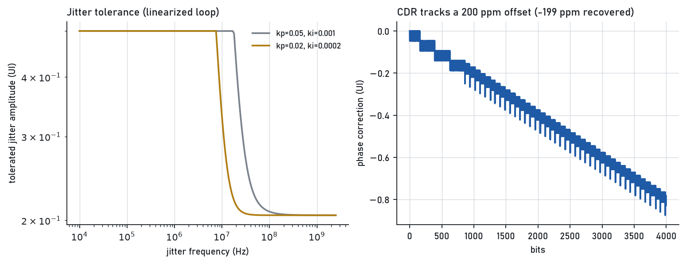
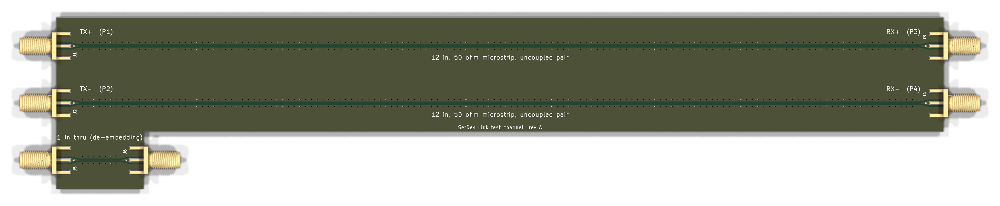
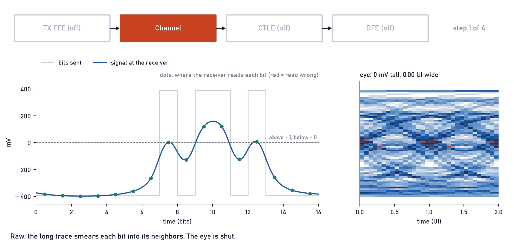

# serdes-link

[](https://github.com/jackpham-rgb/serdes-link/actions/workflows/ci.yml)

A 5 Gb/s serial link, modeled from the transmitter to the recovered bits, with the digital parts rebuilt in SystemVerilog and checked against the model. [Portfolio page](https://jackpham-rgb.github.io/jack-portfolio/)



## Goal and specs

Send 5 billion bits per second down 36 inches of ordinary circuit-board trace and still read every bit correctly at the far end.

That sounds easy until you look at what the trace does. A long trace passes slow changes well and fast changes badly, so each bit smears into the bit slots after it. I learned this smearing has a name, inter-symbol interference, or ISI, and that is what I call it from here on.

The standard way to see ISI is to overlay thousands of received bits on one screen. If the ones and zeros stay apart, there is an open gap in the middle that looks like an eye. That picture is called an eye diagram. A closed eye means the receiver cannot tell a one from a zero.

| Spec | Target | Result |
|---|---|---|
| Bit rate | 5 Gb/s, two-level (NRZ) | 5 Gb/s |
| Channel | 36 in FR4 microstrip, synthetic | 14.9 dB loss at 2.5 GHz |
| Bit error rate | below 1e-12 | below 1e-15 (computed) |
| Eye opening at 1e-12 | open | 126 mV tall, 0.41 of a bit wide |
| Clock offset tolerated | 200 ppm | locks and tracks 200 ppm |
| RTL matches the model | bit for bit | PRBS and clock-recovery filter exact, DFE over 99% of decisions |

## How it works



Each block fixes the smearing in a different way. These are the names engineers use, so I use them too.

- **TX FFE** (feed-forward equalizer). The transmitter sends each bit a little weaker when it repeats the bit before it. This is called de-emphasis. I use the common 3.5 dB setting.
- **CTLE** (continuous-time linear equalizer). An amplifier at the receiver that boosts fast changes more than slow ones, undoing the trace's loss. The amount of boost is called peaking.
- **DFE** (decision-feedback equalizer). Once the receiver has decided a bit, it knows how that bit will smear into the next four, so it subtracts that smear. The four weights are called taps, and they tune themselves with a rule called sign-sign LMS.
- **CDR** (clock and data recovery). The receiver has no clock wire from the transmitter. It watches where the signal crosses zero and steers its own sampling clock to match. Mine is the bang-bang type, which only asks "early or late?" each bit.

Three design decisions mattered most:

1. **Pick a channel that needs the equalizers.** At 12 inches the eye is already open at this speed, so there was nothing to fix. At 36 inches the raw eye is closed.
2. **Measure the eye statistically.** Simulating enough bits to see one error in a trillion is not practical. Instead the model takes the response to one bit, works out every way neighboring bits can add up, and computes the error rate directly. This is called a statistical eye.
3. **Choose CTLE peaking by sweep.** Too little leaves ISI. Too much amplifies noise. The sweep finds the setting with the tallest eye.

## Results

| Step | Eye height at 1e-12 | Eye width at 1e-12 | BER at eye center | Bit errors in simulation |
|---|---|---|---|---|
| Raw channel | 0 mV | 0.00 UI | 2e-02 | 89 of 3700 |
| + TX FFE | 0 mV | 0.00 UI | 5e-07 | 0 of 3700 |
| + CTLE | 115 mV | 0.34 UI | < 1e-15 | 0 of 3700 |
| + DFE | 126 mV | 0.41 UI | < 1e-15 | 0 of 3700 |

UI means unit interval, the time of one bit (200 ps here). BER is bit error rate. The computed error rate for the raw channel (1.9%) agrees with counting errors in the simulated bits (2.4%). The + DFE row uses ideal taps equal to the pulse-response postcursors; the taps that sign-sign LMS actually learns are in the DFE figure below.







The bathtub plot shows error rate against where in the bit the receiver samples. A wider flat bottom means more room for clock error.





In RTL, the PRBS bit generator matches the Python model on all 2000 bits, the clock-recovery loop filter matches on every one of about 4000 steps, and the DFE agrees on over 99% of 4000 decisions. All three run in cocotb with Icarus Verilog.

More detail: [spec](docs/00-spec.md), [link model](docs/01-model.md), [RTL](docs/03-rtl.md), [the math](docs/04-applied-math.md), [supply noise and jitter](docs/05-power-integrity.md).

## What broke and how I fixed it

- **The eye looked closed when it was open.** My eye-height measurement included the dead time before the first bit arrives, so it read zero on an open eye. I caught it when the 12 inch plot plainly showed an open eye next to a number saying closed. The measurement now skips start-up and samples at the eye center.
- **Wrong port order gave a silent zero.** The channel file listed ports in an order the conversion did not expect, and the loss came out as exactly zero with no error. A test against two uncoupled lines caught it.
- **Feedback with the wrong sign.** Both the DFE update and the CDR loop were first written as positive feedback. The DFE tap ran away; the CDR drifted to the edge of the eye from any starting point.
- **A testbench race.** Reading a registered output right after the clock edge returned the old value. Reading after the falling edge fixed it.

## The test board

To check the model against a real trace, I designed a board to measure. It has two 12 in lines, one for each half of the differential pair, and a 1 in line. The short line is called a thru. Measuring it lets me subtract what the connectors add, so only the trace is left. I learned this is called de-embedding.



[Schematic (PDF)](pcb/serdes_test_channel_schematic.pdf), [bill of materials](pcb/serdes_test_channel_bom.csv), and the full design are in [`pcb/`](pcb/).

## Reproduce it

Python 3.10 or newer, plus [Icarus Verilog](https://github.com/steveicarus/iverilog) for the RTL tests.

```bash
python -m venv .venv && source .venv/bin/activate   # .venv\Scripts\activate on Windows
pip install -r requirements.txt
pip install -e .
python -m pytest              # 43 tests; the 3 RTL cosimulations skip without Icarus Verilog
python scripts/run_link.py    # regenerates the figures and results table above
```

## Repo layout

```
src/serdeslink/   the link model: channel, TX, CTLE, DFE, CDR, analysis
scripts/          scripts that produce every figure and number
rtl/              SystemVerilog: PRBS generator, DFE, CDR loop filter
tests/            pytest unit tests and cocotb RTL testbenches
data/touchstone/  the channel S-parameter file and its generator
pcb/              KiCad test board: two 12 in lines and a 1 in thru line
docs/             write-ups, figures, results
```

## Limits and next revision

- The channel is a synthetic model, not a measurement. The test board in `pcb/` is designed and passes design-rule checks but has not been fabricated.
- This is a model plus verified digital blocks. It has not run on an FPGA or silicon.
- The DFE adds little here because the CTLE already removes most of the smear. A lossier channel would show it better.
- Next revision: measure a real trace, and tighten the DFE check to bit-exact with a fixed-point reference model.

## Watch it work

The same bits go down the same trace four times, with one more equalizer switched on each time. On the left, the gray square wave is what was sent and the blue curve is what arrives. Each dot is where the receiver decides 1 or 0, and red dots are wrong reads. On the right, every received bit is stacked on top of the others. The gap in the middle is the eye: the bigger it is, the more room the receiver has before it reads a bit wrong.



Made with `python scripts/make_animation.py`, using the same simulation as the results above.
