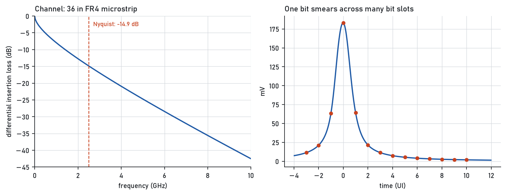
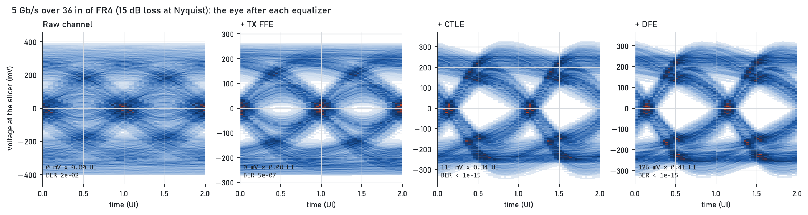
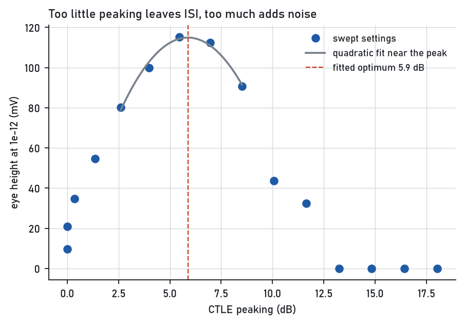
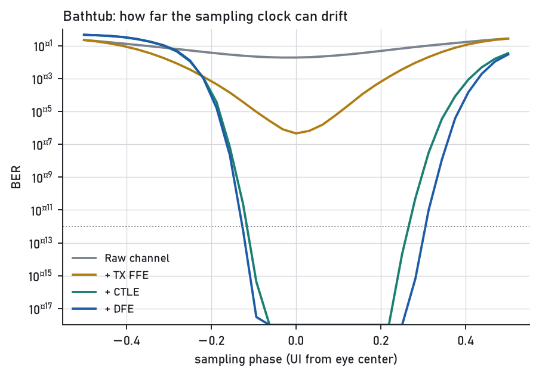
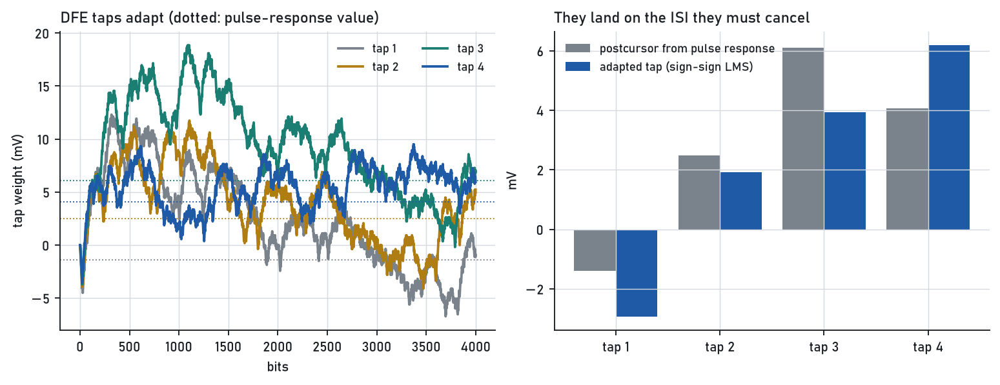
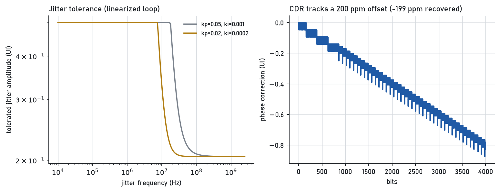

# The link model

## Goal

Model a 5 Gb/s link end to end in Python: a lossy channel, transmitter equalization, a receiver equalizer, decision feedback, and clock recovery. Then show, with numbers, what each equalizer buys back.

## The channel

The channel is 36 inches of FR4 microstrip, generated with scikit-rf (`data/touchstone/make_synthetic_channel.py`) and loaded from a Touchstone file, the standard text format for measured S-parameters. It loses 14.9 dB at 2.5 GHz.

2.5 GHz matters because it is half the bit rate. The fastest pattern a link can send, 1010…, is a square wave at that frequency. I learned this is called the Nyquist frequency, and loss at Nyquist is the number people quote when they say how hard a channel is.



The right panel is the channel's response to one isolated bit, called the pulse response. The dots are one bit apart. The tallest dot is the bit itself, called the main cursor. Every other dot is energy that leaked into a neighboring bit slot: the ones after are postcursors, the ones before are precursors. Together they are the ISI.

`channel.py` converts the four single-ended ports into one differential pair, fills in the missing DC point, and turns the frequency response into an impulse response. Less than 2% of that response's energy arrives before its peak, so the conversion is well behaved.

## The blocks

| Block | Code | What it does |
|---|---|---|
| PRBS | `prbs.py` | A pseudo-random bit sequence. PRBS15 repeats only every 32,767 bits and contains every run length, so it exercises the channel the way real data would. |
| TX FFE | `tx.py` | 2 taps, 3.5 dB de-emphasis: a bit that repeats the previous one is sent weaker. |
| CTLE | `ctle.py` | One zero and two poles (3.5 and 7.5 GHz). Moving the zero lower adds peaking. |
| DFE | `dfe.py` | 4 taps, adapted by sign-sign LMS. |
| CDR | `cdr.py` | Bang-bang phase detector, a two-path digital loop filter, and a phase interpolator with 64 steps per bit. |

## How the eye is measured

Counting errors in a simulation only works down to about one in a few thousand bits. The target is one in a trillion. So the eye is measured statistically (`analysis/stateye.py`):

1. Take the pulse response at the sampling instant.
2. Every postcursor and precursor can add or subtract, depending on the neighboring bits. Convolving one plus-or-minus pair per cursor gives the exact spread of the sampled voltage. This is called the peak-distortion method.
3. Add Gaussian noise: 1 mV rms at the receiver input in a 5 GHz band, shaped by the CTLE.
4. Add random jitter, 0.015 UI rms, by averaging over nearby sampling instants.
5. Read off the error rate at every sampling time and decision threshold.

The eye height and width reported are the opening where the error rate stays below 1e-12. The same PRBS waveform is also simulated bit by bit, as a check that the two methods agree where both can be trusted.

## Results



| Step | Eye height at 1e-12 | Eye width at 1e-12 | BER at eye center | Bit errors in simulation |
|---|---|---|---|---|
| Raw channel | 0 mV | 0.00 UI | 2e-02 | 89 of 3700 |
| + TX FFE | 0 mV | 0.00 UI | 5e-07 | 0 of 3700 |
| + CTLE | 115 mV | 0.34 UI | < 1e-15 | 0 of 3700 |
| + DFE | 126 mV | 0.41 UI | < 1e-15 | 0 of 3700 |

The raw channel's computed error rate (1.9%) agrees with the simulated count (89 of 3700, 2.4%). The FFE alone improves the error rate by four orders of magnitude but still leaves no opening at 1e-12. The CTLE does most of the work here. The DFE adds about 11 mV and 0.07 UI.



The CTLE zero is swept with the FFE on. Eye height rises with peaking, then falls, because past a point the boost amplifies noise faster than it removes ISI. The best swept setting is a 1.32 GHz zero, 5.5 dB of peaking. `analysis/optimize.py` fits a parabola near the peak and solves for its top, as a check that the grid did not miss the optimum.



The bathtub curve is error rate against sampling time. Its flat bottom is the eye width.



The four DFE taps adapt from zero with sign-sign LMS on the simulated waveform (left) and are compared with the postcursors read straight off the pulse response (right). They have the right signs and size, but on a run this short they still wander by a few millivolts. The table uses the ideal DFE, with taps equal to the postcursors.



Left: jitter tolerance, how much sinusoidal timing wobble the receiver survives at each wobble frequency, from a linearized model of the loop. Slow wobble is tracked out, fast wobble eats directly into the eye. Right: the real, bit-level CDR locking onto a 200 ppm frequency offset between transmitter and receiver. The phase correction ramps at 199 ppm once locked.

## Reproduce

```bash
python scripts/run_link.py
```

It writes every figure above, `docs/results.json` and `docs/results_table.md`.

## What went wrong

1. **The eye looked closed when it was open.** My first eye-height measurement took the minimum gap over every trace, including the time before the first bit has even crossed the channel. That made it read near zero on any channel. At 12 inches it reported a closed eye that the plot itself showed wide open. The statistical eye above replaced it, and the bit-by-bit error count checks it.
2. **Wrong differential port order.** I built the channel file with ports grouped as TX+, RX+, TX−, RX−. scikit-rf expects TX+, TX−, RX+, RX−. The result was not an error but a transfer function of exactly zero. A test comparing against two uncoupled lines, where the differential response must equal one line's response, caught it.
3. **Backwards LMS sign.** The DFE update was written as positive feedback. A tap that should settle at 0.3 ran away to about −82. A test on a known one-tap channel caught it.
4. **CDR sign and units.** The loop gains were in bit units but quantized as if they were samples, so most corrections rounded to zero, and the late signal was fed back with the wrong sign. The loop drifted to the edge of the eye from any starting point. I found it by switching the loop off (zero errors) and back on (diverged), and tightened the tests to start from an offset.

## References

- scikit-rf: https://scikit-rf.readthedocs.io
- J. D. H. Alexander, "Clock recovery from random binary signals," Electronics Letters, 1975 (the bang-bang phase detector).
- The peak-distortion statistical eye method, as used in StatEye.
